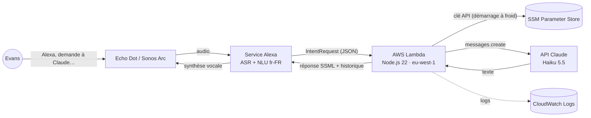

# TRD — Alexa × Claude (V1)

| | |
|---|---|
| **Statut** | Brouillon v0.1 |
| **Date** | 27/10/2026 |
| **Documents liés** | [PRD](01-PRD.md) · [App Flow](03-APP-FLOW.md) · [Backend Schema](05-BACKEND-SCHEMA.md) |

## 1. Vue d'ensemble



Une skill Alexa personnalisée (custom skill) en mode développement reçoit la question, une fonction Lambda la relaie à l'API Claude et renvoie la réponse en SSML. L'historique de la conversation voyage dans les attributs de session Alexa : **aucune base de données en V1**.

## 2. Choix techniques

| Sujet | Choix | Raison | Alternative écartée |
|---|---|---|---|
| Type de skill | Custom skill, locale `fr-FR`, mode développement | Seule option pour une phrase libre ; pas de certification | Alexa+ (pas de choix du modèle) |
| Hébergement | AWS Lambda dans **ton** compte AWS, région `eu-west-1` (Irlande) | Région de l'endpoint Alexa pour l'Europe ; secrets et logs sous ton contrôle ; déploiement depuis le repo GitHub | Skill hébergée par Alexa : plus simple, mais code dans un repo Amazon et gestion des secrets peu pratique |
| Langage | TypeScript, Node.js 22, bundle unique avec esbuild | Typage des payloads Alexa/Claude ; démarrage à froid court | JavaScript pur, .NET (SDK Alexa moins fourni) |
| SDK Alexa | `ask-sdk-core` v2 | SDK officiel, gestion des handlers et attributs de session | Parsing JSON manuel |
| SDK Claude | `@anthropic-ai/sdk` | Officiel, gestion du délai et des erreurs typées | `fetch` brut |
| Modèle | `claude-haiku-5-5` par défaut, configurable | Le plus rapide et le moins cher ; compatible avec la limite de 8 s | Sonnet 5.5 (possible si la latence mesurée le permet) |
| Secret | Clé API en `SecureString` dans SSM Parameter Store, lue au démarrage à froid puis gardée en mémoire | Jamais dans le code, Git ou les paramètres CloudFormation | Variable d'environnement en clair |
| Déploiement | ASK CLI v2 (`ask deploy`) avec le déployeur CloudFormation | Une seule commande déploie le modèle d'interaction et la Lambda | Console à la main |
| Tests | Vitest (unitaires), `ask dialog` (bout en bout), onglet Test de la console | Rapide, sans appareil | — |
| CI | GitHub Actions : lint, typecheck, tests | Garde-fou sur `main` ; déploiement manuel en V1 | Déploiement automatique (prévu plus tard) |

## 3. Composants

### 3.1 Skill package (`skill-package/`)

- `skill.json` : manifeste, locale `fr-FR`, endpoint = ARN de la Lambda.
- `interactionModels/custom/fr-FR.json` : **généré** par un script à partir de `model/carriers.fr-FR.json` (voir §4).
- Nom d'appel : `claude`. Repli si refusé ou mal reconnu : `assistant claude`.

### 3.2 Fonction Lambda (`lambda/`)

| Module | Rôle |
|---|---|
| `index.ts` | Point d'entrée : construit le skill avec `SkillBuilders.custom()`, enregistre handlers, intercepteurs, `withSkillId()` |
| `handlers/launch.ts` | `LaunchRequest` : « Je t'écoute. » |
| `handlers/ask.ts` | Toutes les intentions de question : reconstruit la question, appelle Claude, met à jour l'historique |
| `handlers/builtins.ts` | Aide, Stop, Annuler, Fallback, NavigateHome, nouvelle conversation, `SessionEndedRequest` |
| `handlers/error.ts` | Handler d'erreur global : message parlé, jamais de silence |
| `claude/client.ts` | Client Anthropic (délai, pas de nouvelle tentative), construction de la requête |
| `claude/prompt.ts` | Consigne système (voir [Design Brief](04-UX-VOICE-BRIEF.md)) |
| `conversation/history.ts` | Lecture/écriture/troncature de l'historique dans les attributs de session |
| `speech/sanitize.ts` | Nettoyage Markdown → texte oral, échappement SSML, coupe à une fin de phrase |
| `config.ts` | Lecture et validation des variables d'environnement |
| `secrets.ts` | Lecture de la clé dans SSM, mise en cache au niveau du module |
| `log.ts` | Logs JSON structurés, sans contenu des questions ni des réponses |

### 3.3 Infrastructure (`infrastructure/cfn-deployer/skill-stack.yaml`)

- Fonction Lambda : Node.js 22, arm64, 512 Mo, délai **8 s**.
- Rôle IAM : `ssm:GetParameter` sur le seul paramètre de la clé, `kms:Decrypt` sur la clé KMS gérée par AWS, écriture des logs.
- Permission d'invocation `alexa-appkit.amazon.com` limitée au skill ID (`EventSourceToken`).
- Groupe de logs CloudWatch, rétention 14 jours.
- Le paramètre SSM est créé **à la main** une fois (la valeur ne passe jamais par CloudFormation).

## 4. Capter la question libre

`AMAZON.SearchQuery` capte une phrase libre, mais Amazon impose deux règles : une phrase d'exemple ne peut pas contenir **que** le slot (il faut une phrase porteuse), et elle ne peut pas contenir d'autre slot. Le mot porteur n'est **pas** inclus dans la valeur du slot : « pourquoi le ciel est bleu » arrive comme `le ciel est bleu`.

Pour ne pas perdre les mots interrogatifs, on utilise **une intention par mot porteur significatif**, générée automatiquement :

| Intention | Phrases d'exemple | Préfixe rajouté à la question |
|---|---|---|
| `AskClaudeIntent` | `question {query}`, `dis-moi {query}`, `je me demande {query}`, `de {query}` … | (aucun) |
| `AskPourquoiIntent` | `pourquoi {query}` | `pourquoi` |
| `AskCommentIntent` | `comment {query}` | `comment` |
| `AskQuiIntent` | `qui {query}` | `qui` |
| `AskQuelIntent` | `quel {query}`, `quelle {query}`, `quels {query}`, `quelles {query}` | `quel` (l'accord exact est perdu) |
| `AskCombienIntent` | `combien {query}` | `combien` |
| `AskQuandIntent` | `quand {query}` | `quand` |
| `AskOuIntent` | `où {query}` | `où` |
| `AskQuoiIntent` | `c'est quoi {query}`, `qu'est-ce que {query}`, `que {query}` | `qu'est-ce que` |
| `AskEstCeQueIntent` | `est-ce que {query}`, `est-ce qu'{query}` | `est-ce que` |
| `AskExpliqueIntent` | `explique-moi {query}`, `explique {query}` | `explique-moi` |
| … | liste complète dans `model/carriers.fr-FR.json` | |

Toutes ces intentions sont traitées par le même handler. Avant de reconstruire la question, le handler recolle les élisions qu'Alexa sépare dans le slot (`l' imprimerie` → `l'imprimerie`, `c' est` → `c'est`), constat du [spike](spike-results.md). Une faute d'accord (« quel » au lieu de « quelles ») ne gêne pas Claude. La table se complète au fil des tests réels, sans toucher au code.

> **À valider en phase 0** : l'ouverture en une phrase (« demande à Claude pourquoi… ») et la qualité de capture en français.

## 5. Appel à l'API Claude

```ts
const client = new Anthropic({ apiKey, timeout: cfg.claudeTimeoutMs, maxRetries: 0 });

const res = await client.messages.create({
  model: cfg.claudeModel,          // claude-haiku-5-5
  max_tokens: cfg.claudeMaxTokens, // 300
  system: SYSTEM_PROMPT,
  thinking: { type: "disabled" },  // Haiku 5.5 réfléchit par défaut
  output_config: { effort: "low" },
  messages: [...history, { role: "user", content: question }],
});
```

- **Réflexion désactivée explicitement** : sur Haiku 5.5 la réflexion adaptative est active par défaut, ce qui ajoute de la latence et consomme `max_tokens`. La désactivation n'est acceptée qu'avec un effort `high` ou inférieur. Le spike compare les deux réglages.
- Pas d'outils, pas de streaming en V1.
- **Pas de nouvelle tentative** : un second essai ferait dépasser la limite Alexa.
- Le texte retourné est la concaténation des blocs `text` de `res.content`.
- Si `stop_reason === "max_tokens"`, on coupe à la dernière fin de phrase complète.

## 6. Budget de latence

La skill doit renvoyer sa réponse complète en **8 s environ**, mesurées par Alexa. Une réponse progressive (« Je réfléchis… ») rend l'attente plus supportable mais **ne prolonge pas** ce délai.

| Étape | Budget |
|---|---|
| Démarrage à froid Lambda + lecture SSM (rare) | ≤ 800 ms |
| Traitement de la requête, construction du prompt | ≤ 50 ms |
| Appel Claude (délai coupé côté SDK) | ≤ **6 500 ms** |
| Nettoyage, SSML, sérialisation | ≤ 50 ms |
| Marge réseau | ~ 600 ms |

Délai Lambda : 8 s, pour que le handler d'erreur puisse encore parler si Claude dépasse son budget. La réponse progressive est envoyée **en parallèle** de l'appel Claude (pas en séquence) via le Directive Service, et son échec est ignoré.

## 7. Gestion des erreurs

| Cas | Détection | Ce qu'Alexa dit | Session |
|---|---|---|---|
| Délai Claude dépassé | `APIConnectionTimeoutError` | « Claude met trop de temps à répondre. Essaie une question plus courte. » | Ouverte |
| Limite de débit / surcharge | 429, 529 | « Claude est très demandé en ce moment. Réessaie dans un instant. » | Ouverte |
| Clé invalide, crédit épuisé | 401, 403, 400 « credit » | « Je n'arrive pas à joindre Claude. Vérifie la configuration. » | Fermée |
| Slot vide | `query` absent | « Je n'ai pas compris la question. Tu peux répéter ? » | Ouverte |
| Erreur inattendue | handler d'erreur global | « Oups, quelque chose s'est mal passé. » | Fermée |

Toutes les erreurs sont journalisées avec leur type et le `requestId` Alexa.

## 8. Sécurité

- **Skill ID** vérifié deux fois : permission Lambda (`EventSourceToken`) et `withSkillId()` dans le SDK.
- **Clé API** : `SecureString` SSM, rôle IAM au moindre privilège, jamais loguée.
- **Plafond de dépense** mensuel configuré dans la Console Claude, clé API dédiée à ce projet.
- **Données** : aucune question ni réponse stockée (ni base, ni logs). L'historique vit uniquement dans la session Alexa en cours.
- **Accès** : skill en développement, utilisable seulement par le compte du développeur et ses bêta-testeurs.
- **Confidentialité** : la voix passe par Amazon, le texte par l'API Anthropic. Ne pas poser de questions contenant des données confidentielles de clients.

## 9. Configuration

| Variable | Défaut | Rôle |
|---|---|---|
| `CLAUDE_MODEL` | `claude-haiku-5-5` | Modèle appelé |
| `CLAUDE_MAX_TOKENS` | `300` | Longueur maximale de la réponse |
| `CLAUDE_TIMEOUT_MS` | `6500` | Délai d'appel à Claude |
| `HISTORY_MAX_TURNS` | `6` | Nombre d'échanges question/réponse conservés |
| `ANTHROPIC_API_KEY_PARAM` | `/alexa-claude/anthropic-api-key` | Nom du paramètre SSM |
| `SKILL_ID` | — | Skill ID attendu |
| `PROGRESSIVE_RESPONSE` | `true` | Active « Je réfléchis… » |
| `LOG_LEVEL` | `info` | Niveau de logs |

## 10. Observabilité

Une ligne JSON par requête dans CloudWatch :

```json
{ "level": "info", "event": "ask", "requestId": "amzn1.echo-api.request.…", "intent": "AskPourquoiIntent",
  "model": "claude-haiku-5-5", "latencyMs": 2140, "claudeMs": 1980, "inputTokens": 412,
  "outputTokens": 96, "stopReason": "end_turn", "historyTurns": 2, "coldStart": false }
```

Une requête CloudWatch Logs Insights enregistrée donne p50/p95 de `claudeMs` et le nombre d'erreurs par type. Pas d'alarme en V1.

## 11. Limites connues

- Réponses limitées à quelques phrases ; pas de recherche web ni de sujets d'actualité.
- Les questions qui ne commencent pas par un mot porteur connu peuvent tomber dans `AMAZON.FallbackIntent`.
- Le comportement de la skill quand **Alexa+** est actif sur le compte est à vérifier.
- L'historique est perdu à la fermeture de la session Alexa (silence, « stop », délai d'inactivité).
