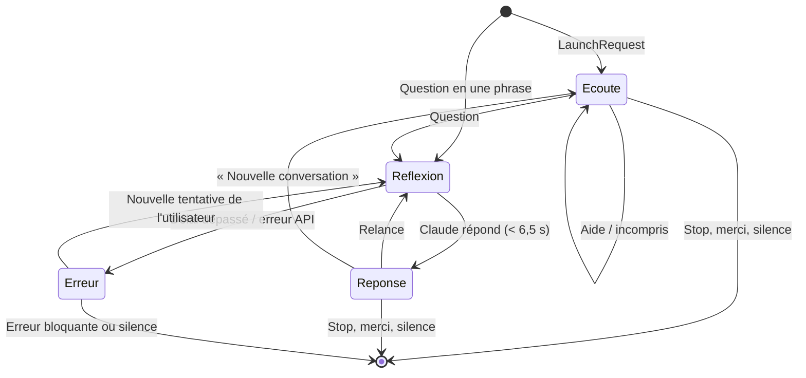
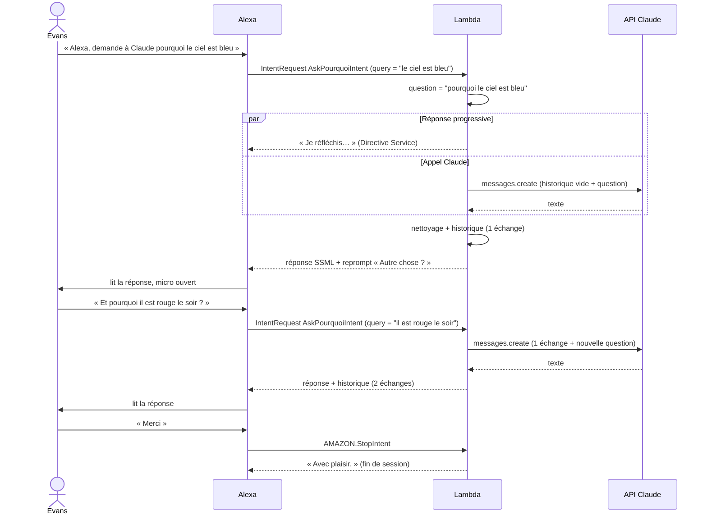

# App Flow — parcours utilisateur (V1)

| | |
|---|---|
| **Statut** | Brouillon v0.1 |
| **Date** | 27/10/2026 |
| **Documents liés** | [PRD](01-PRD.md) · [TRD](02-TRD.md) · [UX vocale](04-UX-VOICE-BRIEF.md) |

Il n'y a pas d'écran : le « parcours » est une conversation. Ce document décrit les états de la session Alexa, les phrases qui font passer de l'un à l'autre et ce que la skill répond. Les textes exacts sont dans le [brief UX vocale](04-UX-VOICE-BRIEF.md).

## 1. Points d'entrée

| Phrase | Requête reçue par la Lambda | Effet |
|---|---|---|
| « Alexa, demande à Claude pourquoi le ciel est bleu » | `IntentRequest` · `AskPourquoiIntent` · `query = "le ciel est bleu"` | Réponse directe (une seule phrase) |
| « Alexa, demande à Claude » | `LaunchRequest` | « Je t'écoute. » |
| « Alexa, ouvre Claude » / « lance Claude » | `LaunchRequest` | « Je t'écoute. » |
| Routine Alexa personnalisée (optionnel) | selon la routine | Raccourci vers la skill |

## 2. Machine à états de la session

| État | Micro ouvert ? | Historique |
|---|---|---|
| Écoute | Oui (réponse avec `reprompt`) | Vide ou conservé |
| Réflexion | Non (traitement Lambda, « Je réfléchis… » si activé) | Lu |
| Réponse | Oui, relance attendue | Question + réponse ajoutées |
| Erreur | Oui si récupérable, sinon non | Inchangé |

Si l'utilisateur ne dit rien après la réponse, Alexa relit le `reprompt` (« Autre chose ? ») une fois, puis ferme la session : Alexa envoie `SessionEndedRequest` et l'historique est perdu.

## 3. Parcours détaillés

### P1 — Question en une phrase, puis relance

### P2 — Ouverture sans question

1. « Alexa, ouvre Claude » → « Je t'écoute. » (micro ouvert).
2. « Comment on fait une pâte à crêpes ? » → réponse, micro ouvert.
3. Silence → « Autre chose ? » → silence → fin de session.

### P3 — Nouvelle conversation

1. Après plusieurs échanges : « Nouvelle conversation » → `NewConversationIntent`.
2. L'historique est vidé → « D'accord, on repart de zéro. Je t'écoute. »

### P4 — Claude trop lent

1. Question complexe → l'appel Claude dépasse 6,5 s.
2. Le SDK coupe l'appel → « Claude met trop de temps à répondre. Essaie une question plus courte. »
3. Micro ouvert, historique inchangé : l'utilisateur peut reformuler.

### P5 — Question non reconnue

1. Phrase qui ne commence par aucun mot porteur → `AMAZON.FallbackIntent`.
2. « Je n'ai pas compris. Commence par exemple ta question par pourquoi, comment ou dis-moi. »
3. Micro ouvert. Chaque cas est journalisé (`event: "fallback"`) pour enrichir `model/carriers.fr-FR.json`.

### P6 — Aide

« Aide » → explication courte et deux exemples, micro ouvert.

## 4. Table des intentions et réponses

| Intention | Déclencheur | Action | Session |
|---|---|---|---|
| `LaunchRequest` | « ouvre Claude » | Accueil | Ouverte |
| `AskClaudeIntent`, `Ask*Intent` | Question | Appel Claude, ajout à l'historique | Ouverte |
| `NewConversationIntent` | « nouvelle conversation », « on change de sujet » | Vide l'historique | Ouverte |
| `AMAZON.HelpIntent` | « aide » | Aide | Ouverte |
| `AMAZON.FallbackIntent` | phrase non reconnue | Message d'aide ciblé | Ouverte |
| `AMAZON.StopIntent`, `AMAZON.CancelIntent` | « stop », « annule », « merci », « c'est tout » | Au revoir | Fermée |
| `AMAZON.NavigateHomeIntent` | requis par Amazon | Comme Stop | Fermée |
| `SessionEndedRequest` | silence, erreur, fermeture | Log uniquement (pas de réponse vocale possible) | Fermée |

« Merci » et « c'est tout » sont ajoutés comme phrases d'exemple de `AMAZON.StopIntent`.

## 5. Hors parcours V1

- « Je cherche et je te rappelle » (annonce différée via Voice Monkey).
- Alexa qui prend la parole d'elle-même (objectif B, annonces Claude Code).
- Reprise d'une conversation d'une session à l'autre.
